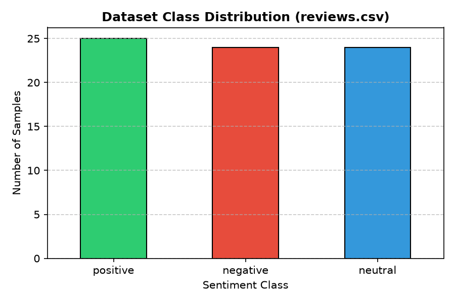
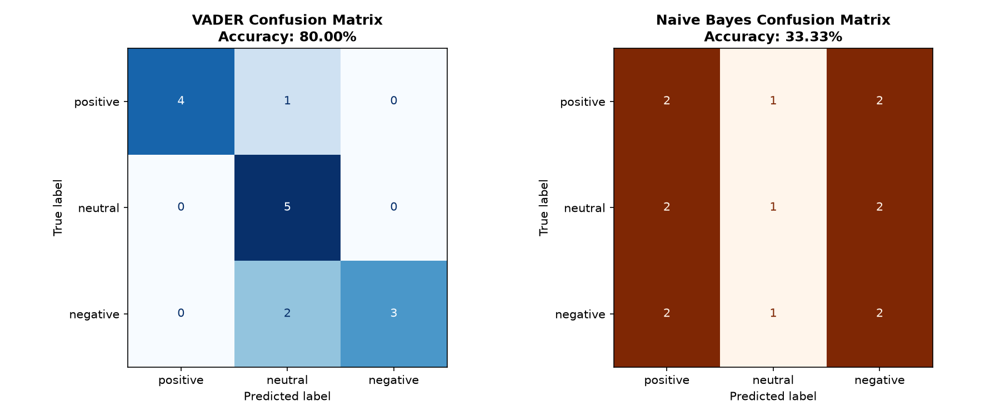

# CodeOrbit Sentiment Analysis & Evaluation Pipeline

## Project Overview & Purpose
A comparative NLP sentiment classification and evaluation pipeline (`sentiment.py`) benchmarking rule-based lexicon scoring (**NLTK VADER**) against a supervised machine learning pipeline (**TF-IDF + Multinomial Naive Bayes**) across `positive`, `neutral`, and `negative` product reviews (`reviews.csv`). Outputs quantitative metrics (`results.txt`), visualizations (`label_distribution.png`, `confusion_matrices.png`), and an analytical findings report ([`REPORT.md`](REPORT.md)).

---

## How It Works (Sentiment Classification Pipeline)
1. **Text Cleaning & Label Visualization:** Normalizes whitespace while intentionally preserving capitalization and punctuation (critical cues for VADER's intensity heuristics), and exports the dataset class balance plot (`label_distribution.png`).
2. **Stratified Holdout Split:** Splits the 73-review dataset (`25` positive, `24` negative, `24` neutral) into an identical 80/20 stratified train/test split (`58` train, `15` test, `random_state=42`) so both models are evaluated fairly on the exact same unseen samples.
3. **Approach A — VADER Lexicon:** Computes a compound valence score using NLTK's `SentimentIntensityAnalyzer` and maps thresholds to classes: `positive` ($\ge 0.05$), `negative` ($\le -0.05$), and `neutral` (between $-0.05$ and $0.05$).
4. **Approach B — TF-IDF + Multinomial Naive Bayes:** Trains `make_pipeline(TfidfVectorizer(stop_words="english", lowercase=True), MultinomialNB())` on the 58 training samples and predicts sentiment probabilities on the 15 test reviews.
5. **Evaluation & Error Audit:** Generates aligned precision/recall/F1 reports, side-by-side confusion matrices (`confusion_matrices.png`), and a sentence-level test error audit saved to `results.txt`.

---

## Setup & How to Run

1. Navigate into the project directory:
   ```bash
   cd CodeOrbit_SentimentAnalysis
   ```
2. Activate the virtual environment (or install from `requirements.txt`):
   - **Windows PowerShell:**
     ```powershell
     .\.venv\Scripts\Activate.ps1
     ```
   - **Git Bash / Linux / macOS:**
     ```bash
     source .venv/Scripts/activate
     ```
   *(Fresh setup: `pip install -r requirements.txt`)*
3. Run the evaluation suite:
   ```bash
   python sentiment.py
   ```

---

## Example Output

```text
 Saved 'label_distribution.png'
 Saved 'confusion_matrices.png'

============================================================
           TASK 5 MODEL EVALUATION SUMMARY                  
============================================================
Total Dataset Rows: 73
Training Samples: 58 | Test Samples: 15
------------------------------------------------------------
Approach A: VADER Test Accuracy        : 80.00%
Approach B: Naive Bayes Test Accuracy  : 33.33%

VADER Classification Report:
              precision    recall  f1-score   support

    positive       1.00      0.80      0.89         5
     neutral       0.62      1.00      0.77         5
    negative       1.00      0.60      0.75         5

    accuracy                           0.80        15
   macro avg       0.88      0.80      0.80        15
weighted avg       0.88      0.80      0.80        15
```

| Metric | VADER (Rule-Based) | Naive Bayes (Supervised) |
|---|---|---|
| **Test Accuracy** | **80.00%** | **33.33%** |
| **Positive F1** | **0.89** | 0.36 |
| **Neutral F1** | **0.77** | 0.25 |
| **Negative F1** | **0.75** | 0.36 |
| **Macro Average F1** | **0.80** | 0.33 |





For full error analysis, failure modes, and improvement recommendations, see [`REPORT.md`](REPORT.md).
