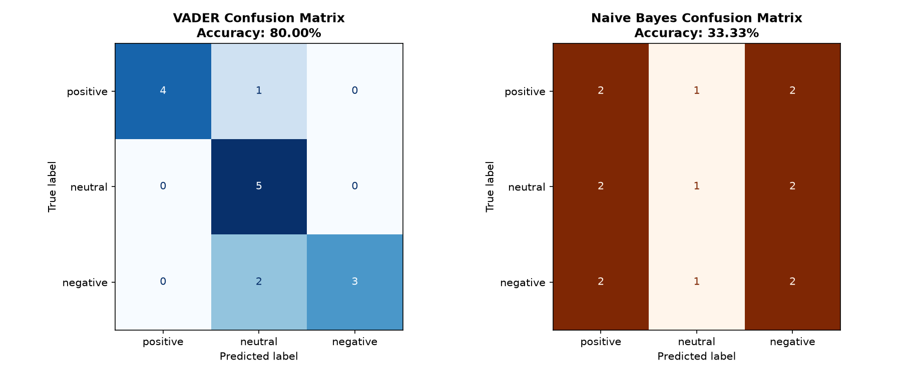
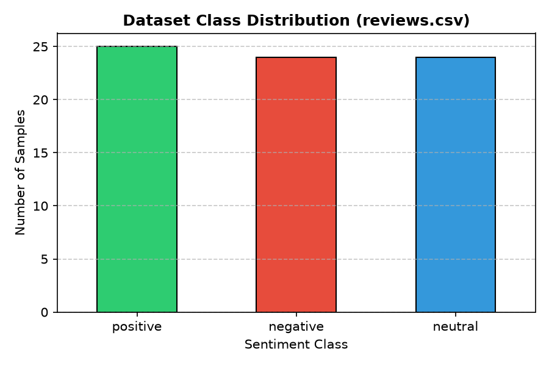

# Comparative Findings Report: VADER vs. TF-IDF Naive Bayes

## 1. Objective
This report evaluates the empirical performance of two natural language processing approaches—a rule-based lexicon (VADER) and a supervised probabilistic classifier (TF-IDF + Multinomial Naive Bayes)—for multi-class sentiment classification on short review text.

## 2. Dataset
- **Total Size:** 73 labeled text records stored in `reviews.csv`.
- **Target Distribution:** 25 positive (34.2%), 24 negative (32.9%), and 24 neutral (32.9%) samples.
- **Data Characteristics:** The dataset consists of short consumer hardware and software reviews, featuring emotional intensity modifiers, punctuation cues, negation clauses, and purely factual neutral statements.

## 3. Methodology
- **Approach A (VADER):** A rule-based sentiment lexicon mapping tokens to emotional valence scores, utilizing grammatical heuristics (capitalization, exclamation marks, negation flips) to produce a compound score. Thresholds: positive ($\ge 0.05$), negative ($\le -0.05$), and neutral ($-0.05 < \text{compound} < 0.05$). Requires zero training data.
- **Approach B (TF-IDF + Multinomial Naive Bayes):** A supervised pipeline extracting unigram TF-IDF features with English stop-word filtering, evaluated using a stratified 80/20 train/test split (58 training samples, 15 holdout test samples) with `random_state=42`.

## 4. Empirical Evaluation Results

Both models were evaluated on the exact same 15-sample stratified holdout test set (5 positive, 5 neutral, 5 negative):

| Metric | VADER (Rule-Based) | TF-IDF + Naive Bayes (Supervised) |
|---|---|---|
| **Overall Accuracy** | **80.00%** | **33.33%** |
| **Positive Precision / Recall / F1** | **1.00** / **0.80** / **0.89** | 0.33 / 0.40 / 0.36 |
| **Neutral Precision / Recall / F1** | 0.62 / **1.00** / **0.77** | 0.33 / 0.20 / 0.25 |
| **Negative Precision / Recall / F1** | **1.00** / **0.60** / **0.75** | 0.33 / 0.40 / 0.36 |
| **Macro Average F1** | **0.80** | 0.33 |

## 5. Test Set Error Audit & Representative Predictions

| Input Sentence | True Class | VADER | Naive Bayes | Failure Analysis |
|---|---|---|---|---|
| `"The screen measures six point five inches diagonally."` | neutral | neutral | negative | Factual sentence correctly mapped by VADER; Naive Bayes had zero vocabulary overlap and guessed incorrectly. |
| `"The meeting is scheduled to begin at ten in the morning."` | neutral | neutral | positive | Neutral sentence correctly classified by VADER; misclassified by Naive Bayes due to absence of domain tokens. |
| `"Cheap plastic materials that creak when held."` | negative | neutral | positive | VADER missed subtle negative context because words like "creak" were not strong valence terms in its dictionary. |
| `"A complete joy to use every single day!"` | positive | positive | negative | VADER captured "joy" strongly; Naive Bayes failed due to vocabulary sparsity. |
| `"Unusable app with constant bugs and slow response times."` | negative | neutral | negative | VADER compound score stayed within the neutral band; Naive Bayes correctly caught the negative token association. |

## 6. Key Findings
1. **Lexicon Superiority in Low-Data Regimes:** VADER achieved 80.00% accuracy without any training, whereas Naive Bayes performed at 33.33% (equivalent to random guessing across 3 balanced classes).
2. **Neutral Class Sensitivity:** VADER achieved 100% recall on the neutral holdout set because purely factual descriptions lack emotional valence. In contrast, Naive Bayes struggled with neutral text (20% recall) due to vocabulary sparsity.
3. **Sarcasm and Subtlety:** Both models stumble on nuanced language. VADER cannot detect sarcasm (e.g., *"Great, another delay..."* scored positive), and it misses descriptive physical flaws that lack explicit emotional keywords (e.g., *"plastic materials that creak"*).

## 7. Limitations & Recommended Improvements
- **Corpus Size:** 58 training samples is insufficient for TF-IDF unigram vocabulary generalization. Expanding the training dataset to 500+ rows would dramatically stabilize supervised performance.
- **N-Grams & Context:** Upgrading `TfidfVectorizer(ngram_range=(1, 2))` would capture phrases like "not good" instead of treating "not" and "good" independently.
- **Model Evolution:** Pretrained transformer models (such as DistilBERT) would provide bidirectional contextual understanding, resolving both vocabulary sparsity and sarcasm limitations.